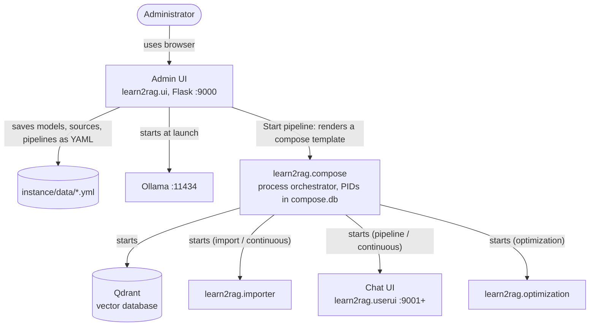
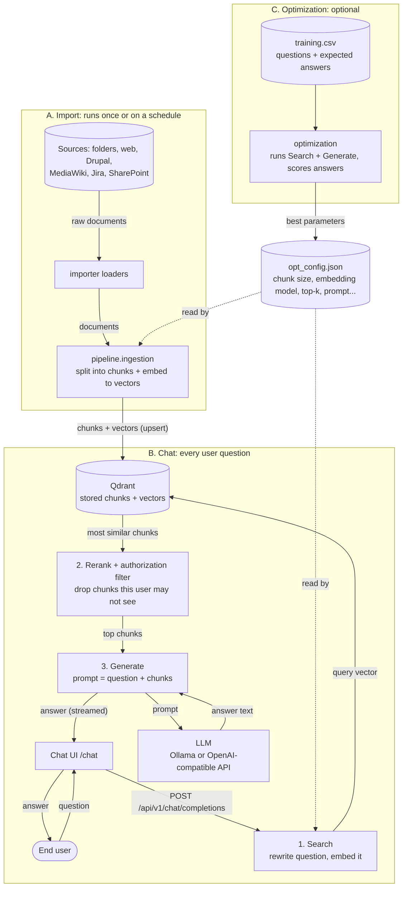

# Architecture

## What it is

Learn2RAG is a self-hosted RAG (retrieval-augmented generation) system. An administrator uses a web UI (the "configurator") to register language models, data sources (local folders, websites, Drupal, MediaWiki, Jira, SharePoint) and pipelines. Each pipeline then runs as a small group of local processes: an importer that indexes documents into a Qdrant vector database, and a chat UI where end users ask questions and get answers grounded in those documents. No Docker is needed. Everything runs as plain processes started from one executable.

User documentation: https://docs.learn2rag.de/

## Big picture

There are two diagrams, because two different things happen: first processes get **started**, then **data flows** through them.

### 1. Who starts what

An arrow means "starts (spawns) this process". Nothing here carries data.

Which processes run depends on the template you choose: **pipeline** starts Qdrant and the chat UI, **import** starts Qdrant and the importer once, **continuous** starts Qdrant, the importer (every N hours) and the chat UI, and **optimization** starts Qdrant and the optimizer.

### 2. How data flows

An arrow means "data moves this way". Read it top to bottom: the importer fills Qdrant (A), a user's question reads from it (B), and optimization tunes the settings both use (C).

After an import, the data does not go anywhere by itself. It stays in Qdrant until a user asks a question. Search then reads it back out, and only the few best-matching chunks are sent to the LLM along with the question.

## Main modules

All Python code lives under `learn2rag/`.

| Module | Responsibility |
|---|---|
| `__main__.py` | **Launcher.** Every process starts as `configurator <module> [args]`. It reads `config.yml` from the CWD, sets up logging, imports the module, builds that module's arguments and calls `module.main(...)`. With `--schedule-interval` it calls `main` repeatedly on a timer (APScheduler). Continuous import uses this. Defaults to `learn2rag.ui`. |
| `ui/` | **Admin UI** (Flask, server-rendered Jinja + htmx, German/English via Babel). CRUD for models, sources and pipelines. Starting a pipeline renders a compose template and hands it to `compose`. On startup it also launches Ollama. |
| `ui/templates/compose/` | **Process templates** (Jinja-rendered YAML). `pipelines/pipeline.yml` (chat only), `import.yml` (one-off import), `continuous.yml` (scheduled import + chat), `optimization.yml`. `components/ollama*.yml` start Ollama or pull a model. |
| `data/` | Tiny persistence layer: each model, source or pipeline is one YAML file under `<instance>/data/<category>/<uuid>.yml`. |
| `compose/` | **Process orchestrator**, a minimal docker-compose for local processes. It writes the files listed in a template, starts `services` (command, env, working dir), runs curl healthchecks and tracks PIDs and status in SQLite (`compose.db`). Handles POSIX process groups and Windows. |
| `importer/` | **Ingestion job.** It reads `importer_config.json`, runs one loader per source (`loaders/*.py`) and passes the documents to `pipeline.ingestion`. In `--delta` mode it keeps `import_state.json` (hashes and timestamps) and only re-indexes changed documents. |
| `pipeline/` | **RAG core.** It covers chunking and ingestion, embeddings (sentence-transformers / BGE-M3: dense, sparse, ColBERT), the Qdrant client, query rewriting, search with reranking, per-source authorization filters (Drupal, SharePoint), generation with LangChain chat models (`llm.py`), and provenance and profiling logs (`prov.py`). `operators/` composes these into async steps. `BasicPipeline` = `SearchOperator` → `GenerationOperator`. `api.py` exposes it over HTTP. |
| `userui/` | **End-user chat app** (FastAPI + uvicorn). It mounts `pipeline.api` under `/api`, serves the llama.cpp web UI as static files under `/chat`, and provides OAuth login (`auth/`) so the pipeline can filter results by what each user may see. |
| `optimization/` | Hyperparameter tuning of `opt_config.json` (retrieval, prompt and contrastive strategies, SMAC/ConfigSpace, bert-score) against a Q&A training CSV that the admin uploads. |
| `bootstrap/` | Shared Bootstrap CSS, images and base templates for both UIs. |
| `ollama_tool.py`, `download_models.py` | Helpers to pull Ollama models and pre-download embedding and reranker models. |
| `evaluation/` | Offline evaluation scripts. Not used at runtime. |

Outside `learn2rag/`:
- `services/`: Qdrant, Ollama and llama.cpp binaries plus their install scripts. `services/llama.cpp` is a submodule; its built web UI is what end users chat in.
- `drupal/`, `mediawiki/`: docker-compose test instances of those sources.
- `ansible/`, `systemd/`: server deployment.
- `pyapp/`, `package-*`, `build-python`: build the single `configurator` binary for release bundles.

## How the pieces connect

### 1. Admin configures and starts a pipeline
1. The admin adds a **model** (an Ollama model to pull, or a URL, token and model name for an OpenAI-compatible API), one or more **sources**, and a **pipeline** that ties a model to sources and a storage directory. Each is saved as YAML through `learn2rag.data`.
2. On "start", `start_pipeline()` in `ui/__init__.py`:
   - builds `importer_config.json` content from the selected sources (mapping `local` → `DirectoryLoader`, `web` → `HTMLLoader`, and so on),
   - picks free ports (`find_free_ports`, preferring 9001–9010),
   - generates a random Qdrant API key,
   - renders the chosen compose template with this context and calls `compose.Project.create(...).start()`.
3. `compose` writes the config files into the pipeline's storage directory and spawns each service. Every service command calls back into the same executable, for example `configurator learn2rag.userui --port 9001 ...`.

### 2. Import (indexing)
`configurator learn2rag.importer --config importer_config.json --delta`. The loaders fetch documents from the sources, then `pipeline.ingestion.index` chunks them, embeds them and upserts them into the Qdrant collection. A continuous pipeline runs the same command with `--schedule-interval PT<n>M` (every 12 h by default).

### 3. Query (chat)
1. The browser loads the llama.cpp UI from `/chat`. That UI calls the relative paths `v1/models` and `v1/chat/completions`. A middleware (`PrefixRewriteMiddleware`) rewrites these from `/chat/...` to `/api/...`.
2. `pipeline/api.py` receives an OpenAI-style chat request and runs `BasicPipeline`:
   - **Search**: optionally rewrite the question using the chat history, embed it, query Qdrant, rerank, then drop documents the user may not access (`authorization.py` with the per-source filters, using the OAuth tokens stored in the user's session).
   - **Generate**: build a prompt with the retrieved context and call the configured LLM.
3. The answer is returned as JSON or streamed as server-sent events. Profiling and provenance lines go to `<storage>/logs/profiling.log`.

## APIs and external services

**Exposed HTTP endpoints**

| Process | Endpoint | Purpose |
|---|---|---|
| Admin UI (`:9000`) | `/`, `/models`, `/sources`, `/pipelines`, `/pipelines/<name>`, `/pipelines/<name>/logs/<file>`, `/pipelines/<name>/training`, `/ps`, `/shutdown` | HTML pages and form POSTs |
| Chat UI (`:9001+`) | `GET /` | Landing page with OAuth login buttons |
| | `/chat/*` | llama.cpp web UI (static), plus `/chat/props` |
| | `GET /api/v1/models` | Returns a single model, `Learn2RAG` |
| | `POST /api/v1/chat/completions` | OpenAI-compatible chat, streaming or not |
| | `POST /api/v1/stream` | Streaming variant |
| | `/auth/oauth/{login,callback,logout}` | OAuth login against a source (Drupal, SharePoint) |

**Outgoing calls**

| Called service | From | How it is configured |
|---|---|---|
| LLM (Ollama or OpenAI-compatible) | `pipeline/llm.py` via LangChain `ChatOllama` / `ChatOpenAI` | `LLM_API_TYPE`, `LLM_API_URL`, `LLM_API_TOKEN`, `LLM_API_MODEL`, `LLM_API_PROXY` |
| Ollama management (list, pull) | `ui/__init__.py` via the `ollama` client | `OLLAMA.port` in `config.yml` (default 11434) |
| Qdrant | `pipeline/qdrant.py` | `QDRANT_LOCATION` (URL) or `QDRANT_PATH` (embedded, on disk), plus `QDRANT__SERVICE__API_KEY` |
| Data sources | `importer/loaders/*` | Per-source settings (URLs, credentials, OAuth client) in `importer_config.json`. Jira can also use `JIRA_USERNAME` / `JIRA_API_TOKEN`. |
| Authorization checks (Drupal, SharePoint / MS Graph) | `pipeline/authorization_*.py` | Uses the end user's OAuth token from the session |
| Hugging Face models (embeddings, rerankers) | `pipeline/embeddings.py`, `search.py`, `download_models.py` | Model names in `opt_config.json` |

**Authentication**
- Admin UI: optional HTTP basic auth via `SIMPLE_AUTH: {username, password}` in `config.yml`. By default it binds to 127.0.0.1 only.
- Chat UI: optional basic auth (`CHAT.username/password`, falling back to `SIMPLE_AUTH`), passed as `--basic-username/--basic-password`. OAuth applications are discovered automatically from sources that have `oauth_client_id` and a client secret. After login, the token is stored in the session and used to filter search results per user.
- TLS for both UIs: `TLS: {CERTFILE, KEYFILE}` in `config.yml`.

## Configuration and environment variables

**Admin-level configuration (YAML, layered):**
1. `learn2rag/ui/config.yml`: built-in defaults such as `SUGGESTED_MODELS`. Users do not edit it.
2. `config.yml` in the working directory (next to the executable): user overrides, merged on top. Main keys: `UI` (`host`, `port`), `CHAT` (`host`, `username`, `password`, `forwarded-allow-ips`), `SIMPLE_AUTH`, `TLS`, `OLLAMA.port`, `PREFERRED_PORTS`, `logging.debug`, `flask.instance_path`.

**Admin UI state:** the Flask instance directory, by default the platform data dir `Learn2RAG/instance` (e.g. `~/.local/share/Learn2RAG/instance`):
- `data/{models,sources,pipelines}/*.yml`: everything the admin created.
- `storage/<pipeline>/`: default per-pipeline storage (Qdrant data, generated configs, logs).
- `ollama/`: Ollama's working directory.

Process state is kept in `compose.db` (SQLite, in the CWD unless `COMPOSE_DB` is set).

**Per-pipeline files** (generated into the storage directory by the compose template):
- `importer_config.json`: the list of loaders and source settings.
- `basic_user_config.json`: collection name and LLM. Read via `PIPELINE_USER_CONFIG`.
- `opt_config.json`: tunable retrieval and generation parameters (chunking, embedding model, top-k, reranker, prompt…), copied from `pipeline/opt_config.json` and overwritten by optimization. Read via `PIPELINE_OPT_CONFIG`. See `pipeline/CONFIG_PARAMS.md`.
- `qdrant_config.yml`, `logging_config.yml`, `logs/{status,error,profiling,debug}.log`.

**Environment variables set for pipeline processes** (see `ui/templates/compose/pipelines/*.yml`):
`LEARN2RAG_PATH`, `STORAGE_PATH`, `PIPELINE_USER_CONFIG`, `PIPELINE_OPT_CONFIG`, `IMPORTER_CONFIG`, `QDRANT_LOCATION`, `QDRANT_PATH`, `QDRANT__SERVICE__API_KEY`, `LLM_API_TYPE`, `LLM_API_URL`, `LLM_API_TOKEN`, `LLM_API_MODEL`. `pipeline/config.py` loads the three JSON configs at import time from these variables, falling back to the copies in `learn2rag/pipeline/`.